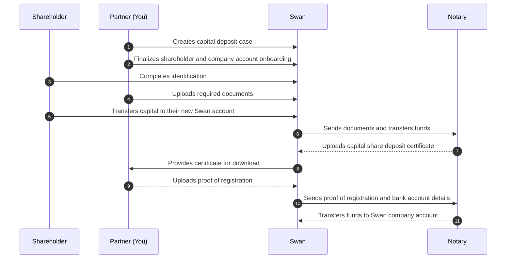

# Capital deposit process

A <Term id="capital-deposit">capital deposit</Term> involves four parties:

- **You**, the partner driving the integration.
- **Your user**: the future company and its [shareholders](/accounts/concepts/capital-deposits/shareholders).
- **Swan**, through the Swan API.
- The **notary**.

Together, these parties complete a few main actions, from opening the case to wiring the funds to the new company.

## Main actions {#actions}

```flowmap
{
  "mode": "pathway",
  "items": [
    { "type": "Guide", "title": "Create a capital deposit case", "to": "/accounts/guides/capital-deposits/create-case-v2", "desc": "Open the case object that collects the company, accounts, shareholders, and documents." },
    { "type": "Guide", "title": "Create the company and shareholder accounts", "to": "/accounts/guides/onboarding", "desc": "Onboard the future company and each shareholder so they each get a Swan account." },
    { "type": "Concept", "title": "Complete identity and account holder verification", "to": "/accounts/concepts/account-holders/verification", "desc": "Each shareholder completes identification and account holder verification." },
    { "type": "Guide", "title": "Upload the required documents", "to": "/accounts/guides/capital-deposits/upload-documents", "desc": "Upload the required documents for the shareholders and the future company." },
    { "type": "Concept", "title": "Transfer the capital funds", "to": "/accounts/concepts/capital-deposits/shareholders#transfer-requirements", "desc": "Each shareholder transfers their capital to their temporary Swan account." },
    { "type": "Guide", "title": "Register the company", "to": "/accounts/guides/capital-deposits/deposit-capital#upload-kbis", "desc": "Register the company with the capital share deposit certificate, then upload its KBIS." },
    { "type": "Guide", "title": "Release the funds to the company account", "to": "/accounts/guides/capital-deposits/deposit-capital#transfer-funds-company", "desc": "The notary transfers the capital to the company account." }
  ]
}
```

Once shareholders have transferred their capital, Swan and the notary complete the deposit: Swan sends the documents and funds to the notary, the notary issues the capital deposit certificate, you upload the proof of registration, and the notary releases the funds to the company account.

The Dashboard shows the progress of each case: [Manage a capital deposit case](/accounts/guides/capital-deposits/deposit-capital) walks through each stage.

## Capital deposit case {#case}

The [`CapitalDepositCase`](https://api-reference.swan.io/objects/capital-deposit-case) API object is the spine of the process: it compiles everything for a single deposit.

- Details about the future company
- Company account information
- [Shareholder](/accounts/concepts/capital-deposits/shareholders) information
- [Capital deposit documents](#documents)

The case moves through several [statuses](/accounts/concepts/capital-deposits/statuses#case), and a [cancelation reason code](/accounts/reference/capital-deposits#cancelation-reason-codes) explains any cancelation.

## Required documents {#documents}

Processing a capital deposit requires several documents from shareholders and the future company, [uploaded with the API](/accounts/guides/capital-deposits/upload-documents). Document upload can take place in parallel with shareholder onboarding and <Term id="kyc">KYC</Term>, so documents can be uploaded as soon as they become available. A document that doesn't meet Swan's requirements is assigned the [status `Refused`](/accounts/concepts/capital-deposits/statuses#documents) and must be uploaded again; all [required documents are listed in the reference](/accounts/reference/capital-deposits#documents-list).

## Sequence diagram {#diagram}

The full choreography between you, the shareholders, Swan, and the notary, from creating the case to the notary transferring funds to the company account:


