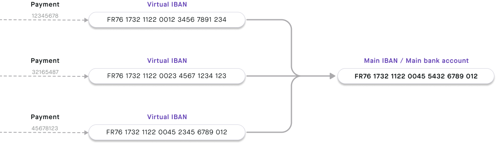

# Virtual IBANs

You can create multiple virtual <Term id="ibans">IBANs</Term> for one account, which can be used to accept payments.
Differentiate between main and virtual IBANs by their bank details: depending on the country, they use a different branch code, bank code, or IBAN type digit. Refer to [local IBANs](/accounts/concepts/ibans/local) for each country's structure.
Virtual IBANs can't be used to send SEPA Credit Transfers.

## Working with virtual IBANs {#working-with}

Add virtual IBANs from your **Dashboard** > **Data** > **Accounts** > **Virtual IBANs**, or with the [API](/accounts/guides/ibans/add-virtual). 
To add virtual IBANs, the [`PaymentAccountType` must be `PaymentService` and the `PaymentLevel` must be `Unlimited`](/accounts/concepts/account/type-and-level).
You can cancel a virtual IBAN, but you can't suspend one: the API has no mutation for it.

View an account's virtual IBANs on your **Dashboard** > **Data** > **Accounts** > **Virtual IBANs**, or with the API by querying `account` > `virtualIbanEntries`.
If you use [Swan's Web Banking frontend](https://swan-io.github.io/swan-partner-frontend/specs/banking/account#virtual-ibans), your users can view their virtual IBANs on **Account** > **Virtual IBANs**.

<Term id="account-holder">Account holders</Term> can use virtual IBANs to receive SEPA Credit Transfers and to set up outgoing SEPA Direct Debit transactions.

:::note Example
Use virtual IBANs to make paying invoices with credit transfers smoother by providing a different virtual IBAN to each client. You'll know exactly who is paying you, plus when and how much, simplifying reconciliation.
:::

## Refusing SEPA Direct Debits {#refuse-sdd}

To refuse all SEPA Direct Debits received on an account, call the [`denySdd`](https://api-reference.swan.io/mutations/deny-sdd/) mutation.
It applies to the account's main IBAN and to all of its virtual IBANs.
To accept SEPA Direct Debits again, call the [`allowSdd`](https://api-reference.swan.io/mutations/allow-sdd/) mutation.

The `blockSDD` field is `true` on the account and on each virtual IBAN while they refuse SEPA Direct Debits.

## Virtual IBAN statuses {#statuses}

Each virtual IBAN has a `status`.

| Status | Explanation |
| --- | --- |
| `Enabled` | The virtual IBAN accepts incoming SEPA payments. |
| `Suspended` | The virtual IBAN temporarily refuses incoming SEPA payments. |
| `Canceled` | The virtual IBAN permanently refuses incoming SEPA payments. |
