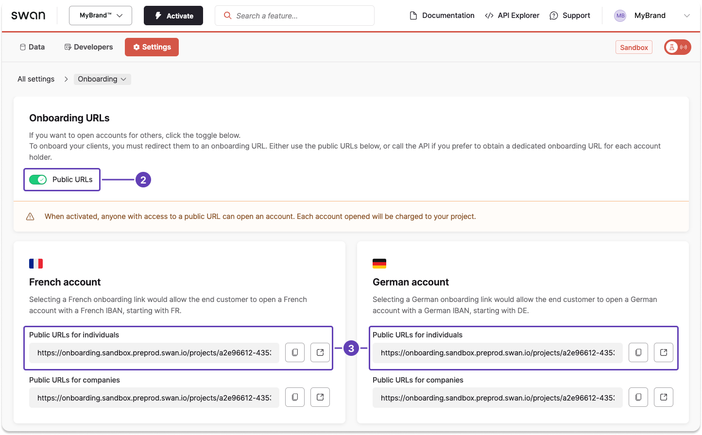

import PublicOnboardingUrl from '../../partials/_create-public-url.mdx';

# Create an individual onboarding link from the Dashboard

Share your project's public individual onboarding link from your Dashboard.

## Public link {#public-link}

<PublicOnboardingUrl />

In Live, links for individuals only appear if Swan has approved individual onboarding for your project. See [Onboarding](/accounts/concepts/onboarding#types).

