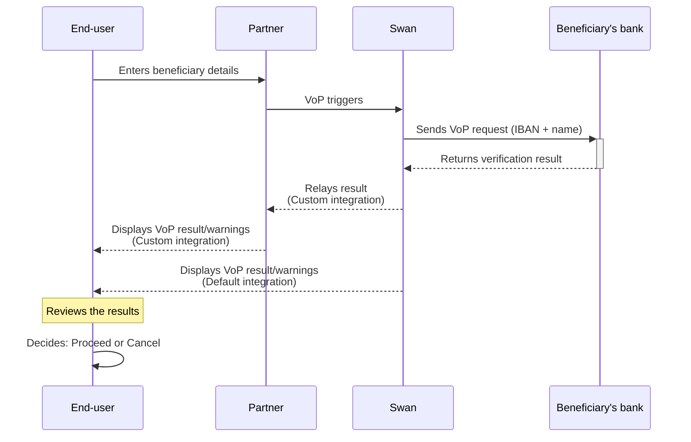
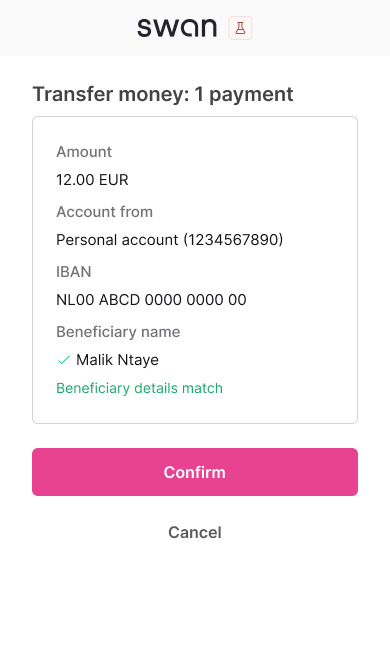
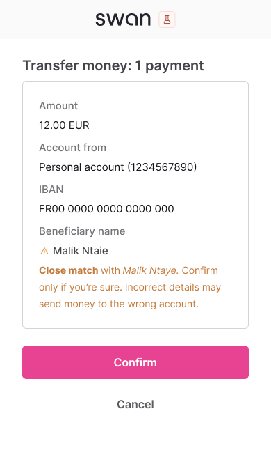
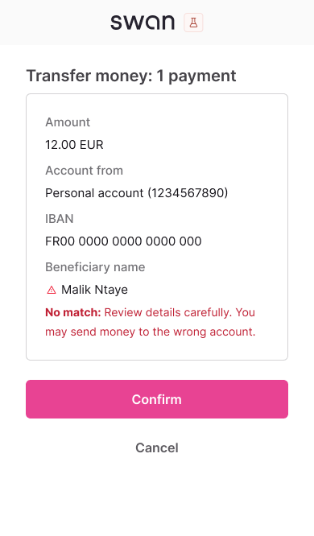
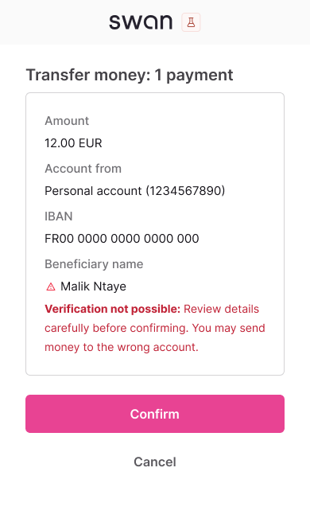

# Verification of Payee

<p className="ia-lede"><Term id="verification-of-payee">Verification of Payee</Term> (VoP) checks beneficiary details against the <Term id="account-holder">account holder</Term> registered at the beneficiary's bank before a <Term id="credit-transfer">SEPA Credit Transfer</Term> is sent, to reduce fraud and payment errors.</p>

import VerificationOfPayeeDefinition from '../../../_shared/definitions/_verification-of-payee.mdx';

> <VerificationOfPayeeDefinition />

:::info Mandatory compliance
Required for all SEPA Credit Transfers and Instant SEPA Credit Transfers under the [European Instant Payments Regulation (IPR)](https://www.ecb.europa.eu/paym/integration/retail/instant_payments/html/instant_payments_regulation.en.html) published in March 2024, for all Payment Service Providers (PSPs) in the Eurozone offering SEPA Credit Transfers.
:::

## Geographic scope and timeline {#coverage}

VoP applies to all countries in the SEPA region. Payment Service Providers (PSPs) have varying implementation timelines based on their location:

| Payment Services Provider location | VoP mandatory date |
| --- | --- |
| [Eurozone](https://economy-finance.ec.europa.eu/euro/what-euro-area_en) | October 9, 2025 |
| Non-Eurozone | January 9, 2027 |

The service is **free of charge** for Swan account holders as mandated by the regulation.

## Swan's VoP capabilities {#swan-vop-capabilities}

Swan acts as both a requesting and a responding PSP.

- **Outgoing**: Swan verifies the beneficiary with the receiving bank before processing the transfer; you choose an [integration option](/payments/concepts/verification-of-payee/integration-options).
- **Incoming**: Swan answers other PSPs' requests automatically from the account holder's details, nothing to implement; refer to [incoming VoP requests](/payments/concepts/verification-of-payee/incoming-requests).

## How VoP works {#how-vop-works}

### High-level flow {#high-level-flow}

Swan sends the beneficiary's bank the <Term id="ibans">IBAN</Term> and the name. Following the [EPC's recommended matching rules](https://www.europeanpaymentscouncil.eu/sites/default/files/kb/file/2024-10/EPC288-23%20v1.0%20EPC%20Recommendations%20for%20the%20Matching%20Processes%20under%20the%20VOP%20Scheme%20Rulebook_0.pdf), the name is the first and last name of a natural person (individual), or the legal or commercial name of a legal person (company).



:::caution Swan relays results: it doesn't determine them
For outgoing VoP requests, results are determined solely by the **beneficiary's bank** (the creditor's PSP). Swan sends the verification request and displays the result exactly as received. Swan has no influence over the outcome and can't modify or override it.

If a result seems unexpected, the beneficiary's bank made that determination based on their own matching logic.
:::

### VoP results {#vop-results}

The beneficiary's bank can return one of four verification results. **All results must be displayed to the end-user**. Swan will systematically display the VoP result and warning on the SCA <Term id="consent">consent</Term> screen.

<Tabs>
  <TabItem value="match" label="Match" id="vop-match" default>
    **Result**: Exact match found between provided details and account holder information
    
    **End-user action**: Safe to proceed with transfer
    
    **Mobile consent screen**:
    <div style={{width: 'fit-content', margin: 'auto', border: '1px solid #e5e7eb', borderRadius: '8px', overflow: 'hidden'}}>
      
    </div>
  </TabItem>
  
  <TabItem value="close" label="Close match" id="vop-close">
    **Result**: Close match with suggested correction from beneficiary's bank
    
    **End-user action**: Review suggested name correction before proceeding
    
    **Mobile consent screen**:
    <div style={{width: 'fit-content', margin: 'auto', border: '1px solid #e5e7eb', borderRadius: '8px', overflow: 'hidden'}}>
      
    </div>
  </TabItem>
  
  <TabItem value="no-match" label="No match" id="vop-no-match">
    **Result**: No match found between provided details and account holder information
    
    **End-user action**: Verify beneficiary details carefully before proceeding
    
    **Mobile consent screen**:
    <div style={{width: 'fit-content', margin: 'auto', border: '1px solid #e5e7eb', borderRadius: '8px', overflow: 'hidden'}}>
      
    </div>
  </TabItem>
  
  <TabItem value="not-possible" label="Verification not possible" id="vop-not-possible">
    **Result**: The beneficiary couldn't be verified, for example because of an invalid IBAN format.
    
    **End-user action**: Verify beneficiary details carefully before proceeding
    
    **Mobile consent screen**:
    <div style={{width: 'fit-content', margin: 'auto', border: '1px solid #e5e7eb', borderRadius: '8px', overflow: 'hidden'}}>
      
    </div>
  </TabItem>
</Tabs>

### User liability with Verification of Payee {#user-liability}

VoP informs the user; it never blocks the payment. Users who authorize a transfer after a Close match, No match, or Verification not possible warning accept the associated risks:

- The user bears responsibility if funds reach the wrong account.
- Refunds are not available for misdirected transfers.

Users can find complete VoP liability information in their Swan account's Terms and Conditions.

### Standing Orders {#standing-orders}

VoP applies to <Term id="standing-order">Standing Orders</Term> with two key differences:

1. **Initial verification only**: VoP happens at the scheduling stage when creating the Standing Order.
2. **Existing Standing Orders**: Standing Orders authorized before October 9, 2025 aren't verified. Every Standing Order created since then is.

## Integration options {#integration-flows}

Swan offers two compliant ways to meet the requirement. With [default verification](/payments/concepts/verification-of-payee/integration-options#option-1), Swan runs the check inside `initiateCreditTransfers` and shows the result on the consent screen: nothing to implement for single transfers. With [custom verification](/payments/concepts/verification-of-payee/integration-options#option-2), you call `verifyBeneficiary` first and show the result yourself; required for bulk transfers.
Refer to [VoP integration options](/payments/concepts/verification-of-payee/integration-options) for the comparison and the supported payment types.

## Bulk credit transfers {#bulk-credit-transfers}

Bulk credit transfers require [custom verification](/payments/concepts/verification-of-payee/integration-options#option-2). Whether the token is mandatory depends on the account type and an account-level setting.
Refer to [bulk credit transfers with VoP](/payments/concepts/verification-of-payee/bulk-transfers#bulk-requirements) for the defaults and who can change them.

## In this section

```flowmap
{
  "mode": "pathway",
  "items": [
    { "title": "Integration options", "to": "/payments/concepts/verification-of-payee/integration-options", "desc": "Default verification by Swan, or custom verification with the mutation." },
    { "title": "Bulk credit transfers", "to": "/payments/concepts/verification-of-payee/bulk-transfers", "desc": "Token requirements by account type and the account-level setting." },
    { "title": "Incoming VoP requests", "to": "/payments/concepts/verification-of-payee/incoming-requests", "desc": "How Swan answers other banks' verification requests." }
  ]
}
```
