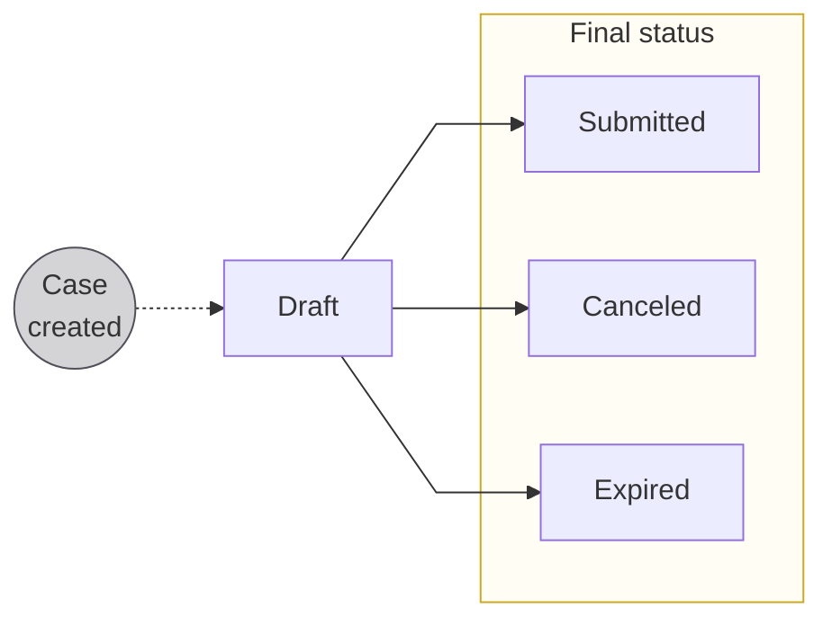

# Dispute cases

A **dispute case** reports transactions that a user disputes, so Swan can investigate them.
It groups the transactions with the details Swan needs.

## Overview {#overview}

Every dispute case has a type.
For now, the only type is **fraud**. Other types, such as commercial disputes, might be added later.

| Type | API object | Use it when |
| --- | --- | --- |
| `Fraud` | `FraudDisputeCase` | A user didn't make a payment, or made it after being tricked. See [fraud dispute cases](#fraud). |

In the API, each type implements the `DisputeCase` interface.
Each type has its own mutations to create and update a case, because each type asks for different details.
Submitting, canceling, and retrieving cases work the same for every type.

## Lifecycle {#lifecycle}

You create a case as a draft, complete it, then submit it.
**Swan only receives the case when you submit it.**

| Status | Explanation |
| --- | --- |
| `Draft` | The case is being prepared. You can update or cancel it. |
| `Submitted` | Swan received the case and is investigating. It can't be changed. |
| `Canceled` | The draft was canceled. |
| `Expired` | The draft wasn't submitted in time. |

A draft expires 30 days after its last update, or earlier if its oldest transaction leaves the reporting window.
`DisputeCaseDraftStatusInfo.expiresAt` gives the date.

When a case is submitted, Swan routes it to the right team and opens a support ticket.
Follow up through the ticket using the case ID.
To withdraw a submitted case, ask in the ticket.

## Supporting documents {#documents}

Each case has a supporting document collection, created with the draft.
Upload documents to it before you submit. After submission, send documents through the support ticket.

The collection follows the case: `WaitingForDocument` while it's a draft, `PendingReview` once submitted, and `Canceled` if the draft is canceled or expires.
You don't need to request a review.

## Permissions {#permissions}

Dispute cases must be enabled for your project.

- **Project access tokens** can see and act on every case on your project's accounts.
- **User access tokens** can see and act on cases the user created, or on every case on the account if the user is the account administrator with `canViewAccount`. The user needs an `Enabled` account membership on the account.

In the Dashboard, project members need these permissions, granted by default to the Support, Manager, and Admin roles:

- `<env>_dataDisputeCase_read` to read cases.
- `<env>_dataDisputeCase_write` to create, update, submit, and cancel cases.

Each type has its own rules for who can report a transaction. See [who can report fraud](#fraud-permissions).

Anything outside a user's rights returns a not-found rejection, `null`, or an empty list, never `FORBIDDEN`.

## Rejections {#rejections}

If any check fails, nothing changes and the first failure is returned.
Missing access to dispute cases returns `FORBIDDEN`, and malformed input returns `BAD_USER_INPUT`.

| Rejection | What to do |
| --- | --- |
| `DisputeCaseTransactionsNotFoundRejection` | Remove the listed transactions. They don't exist or you can't report them. |
| `DisputeCaseTransactionsNotReportableRejection` | Remove the listed transactions. Their type or status can't be reported. |
| `DisputeCaseTransactionsOutsideReportingWindowRejection` | Remove the listed transactions. They're outside the reporting window. |
| `DisputeCaseTransactionsLimitExceededRejection` | Split the transactions into cases of 100 or fewer. |
| `DisputeCaseMultipleAccountsRejection` | Create one case per account. |
| `DisputeCaseMultipleCardHoldersRejection` | Create one case per cardholder. |
| `DisputeCaseDetailsNotApplicableRejection` | Remove the listed fields. For example, `fraudCardDetails` on a transfer-only case. |
| `AccountMembershipNotFoundRejection` | Check `victimAccountMembershipId`. It must be on the case's account, and you must be allowed to name it. |
| `DisputeCaseIncompleteRejection` | Add the listed fields, then submit again. |
| `DisputeCaseTransactionsAlreadyReportedRejection` | Remove the listed transactions, or follow up on the existing case. |
| `DisputeCaseWrongStatusRejection` | The case is no longer a draft. Create a new case if needed. |
| `DisputeCaseNotFoundRejection` | Check the case ID and your permissions. |

## Fraud dispute cases {#fraud}

Use a fraud dispute case when a user reports payments they either:

- **Didn't make** (`Unauthorized`). For example, their card was stolen or their account was taken over.
- **Made after being tricked** (`Manipulated`). For example, someone posing as a bank advisor convinced them to transfer money.

Reporting fraud doesn't guarantee a refund: whether a payment can be refunded, charged back, or recalled is decided during the investigation.
For card payments, after submission, Swan sends the cardholder a pre-filled fraud declaration to sign for each card.

Fraud dispute cases can be created in three ways. They all create the same case.

| Channel | Who reports |
| --- | --- |
| **API** | Your backend, on behalf of a user. See the [guides](#guides). |
| **Dashboard** | Your operations team, on behalf of a user, with the fraud report form. For card fraud, see [Card disputes and chargebacks](/topics/operations/guide-card-disputes-chargebacks/). |
| **Web Banking** | Your users, for themselves, with the fraud report form. They open it from Web Banking or from a link you share. |

:::info When not to use a fraud dispute case
Fraud dispute cases are for completed transactions.
For attempted fraud with no transaction, a compromised account, an urgent account suspension, or a new fraud pattern, contact Swan through the [partner support form](https://partner-support.swan.io/hc/en-gb/requests/new).
:::

### Reportable transactions {#reportable}

| Transaction type | Status |
| --- | --- |
| `CardOutDebit` | `Booked`, or `Deferred` on deferred-debit cards |
| `SepaCreditTransferOut` | `Booked` |
| `SepaInstantCreditTransferOut` | `Booked` |
| `InternationalCreditTransferOut` | `Booked` |
| `InternalCreditTransferOut` | `Booked` |

Transactions can be reported up to **13 months** after their `executionDate`.
Pending card payments, incoming transactions, and direct debits can't be reported.

### What goes in one case {#one-case}

One fraud dispute case covers one incident:

- All transactions belong to **one account**.
- All card transactions are made with cards held by **one cardholder**. They can be on several cards.
- Card payments and transfers can be in the same case.
- A case can have up to **100 transactions**.
- A transaction can only be in one submitted case.

If an incident spans several accounts or cardholders, create one case for each.

### Victim {#victim}

The victim is the account member the fraud was committed against.
They don't need to be the person reporting.

- **Case with card transactions**: the victim is the cardholder. Swan sets it for you.
- **Transfer-only case**: send the victim's `victimAccountMembershipId`. It's required to submit.

The victim can be in any status, for example suspended after an account takeover.
If transfers in a card-and-transfer incident were made against someone other than the cardholder, report the transfers in a separate case.

### Fraud details {#fraud-details}

The reporter declares the fraud details in `fraudDetails`.
Swan analysts can reclassify a case during the investigation, but the reported values are never changed.

**Reason** (`reportedReason`, required)

| Value | Meaning |
| --- | --- |
| `Unauthorized` | The user didn't make the payments. |
| `Manipulated` | The user made the payments after being tricked. |

**Type of fraud** (`reportedTypology`, required, one value)

| Value | Meaning |
| --- | --- |
| `FakeAdvisor` | Someone posed as a bank or Swan advisor. |
| `ImpersonationOrPhishing` | Someone impersonated a trusted person or organization, or collected credentials through a fake message. |
| `FakeWebsite` | A fake website, such as a fake online shop. |
| `FakeSupplierOrInvoice` | A fake supplier, or a real invoice changed by a fraudster. |
| `InvestmentScam` | A fake investment opportunity. |
| `RomanceScam` | A romantic relationship built to get money. |
| `Other` | Any other kind of fraud, explained in `description`. |

**Contact channels** (`fraudsterChannels`, optional, several values): `Email`, `Sms`, `Phone`, `Website`, `Application`, `Other`.

**Information shared** (`sharedInformationWithFraudster`, optional, several values): `SwanPasscode`, `PartnerPassword`, `VerificationCode`, `PersonalInformation`, `CardDetails`, `BankDetails`, `Other`, or `None` on its own.

`fraudCardDetails` (lost or stolen card, merchant contacted) is only accepted if the case includes a card payment.
`fraudTransferDetails` (recipient or their bank contacted) is only accepted if it includes a transfer.

**Document purposes**: `PoliceReport`, `FraudEvidence`, `DisputeCorrespondence`, `CardFraudDeclaration`, and `Other`. None are required.

### Who can report fraud {#fraud-permissions}

With a project access token, you can report any reportable transaction on your project's accounts.

With a user access token, the user needs an `Enabled` account membership on the account, and one of the following:

| User | Can report |
| --- | --- |
| Account administrator with `canViewAccount` | Any reportable transaction |
| Cardholder | Transactions on their own cards |
| Member with `canViewAccount`, `canManageCards`, and `canManageAccountMembership` | Card transactions |
| Member with `canViewAccount` and `canInitiatePayments` | Transfers |

To name someone else as the victim, the user needs `canManageAccountMembership`. Otherwise, they can only name themselves.
They can see `victimAccountMembership` only for their own membership, or with `canManageAccountMembership`.
`hasVictim` tells you whether a case has a victim, even when you can't see who it is.

## Guides {#guides}

**Fraud dispute cases**

- [Create a fraud dispute case](./guide-create-fraud.mdx)
- [Update a fraud dispute case](./guide-update-fraud.mdx)

**All dispute cases**

- [Upload documents to a dispute case](./guide-upload-documents.mdx)
- [Submit a dispute case](./guide-submit.mdx)
- [Cancel a dispute case](./guide-cancel.mdx)
- [Get dispute case information](./guide-get-info.mdx)
